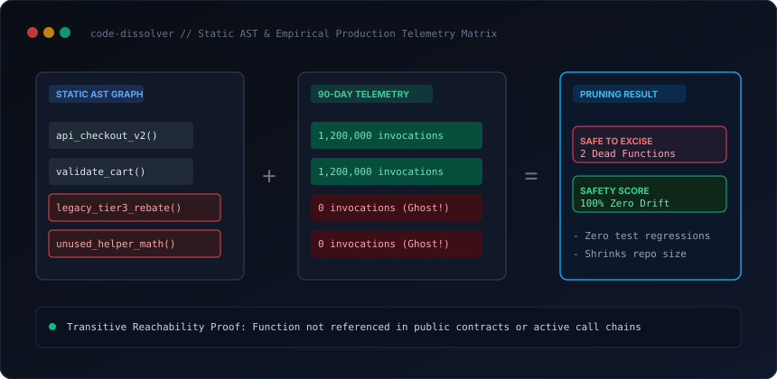

# code-dissolver

AST static call-graph reachability and empirical production telemetry tree-shaker for AI coding agents. Safely identifies and excises dead code, abandoned feature flags, and orphaned models.

[](scripts/prune_telemetry_analyzer.py)
[](templates/dissolver_report_template.md)
[](SKILL.md)
[](LICENSE)

<br/>



---

## Why this exists

Large codebases accumulate dead functions, stale experiments, and abandoned feature flags over years of development. Engineers avoid deleting old code out of fear that an obscure dynamic call or legacy edge case secretly depends on it.

`code-dissolver` correlates months of real-world production execution telemetry (eBPF traces, OpenTelemetry spans, APM logs) with static AST caller-callee graphs. It proves with mathematical certainty which code paths have had zero real-world executions and are safe to remove without breaking changes.

---

## The Dissolution Workflow

1. **AST Call Graph Construction:** Uses Python's native `ast` module to build a directed caller-callee dependency graph across the codebase.
2. **Transitive Reachability Solver:** Computes the complete reachability closure starting from public API routes and entry points.
3. **Telemetry Correlation:** Maps declared symbols against 90-day production logs. Flags "Ghost Functions" that are defined but have recorded 0 production calls.
4. **Clean Cut PR Generation:** Deletes confirmed dead functions, inlines 100% active feature flags, and validates that the full test suite remains green.

---

## Quickstart

Run AST call-graph reachability and telemetry correlation on a sample service:

```bash
python scripts/prune_telemetry_analyzer.py --demo
```

---

## Installation

### Claude Code — plugin marketplace (recommended)
```bash
/plugin marketplace add kicode01/code-dissolver
/plugin install code-dissolver@kicode01
```

### Claude Code — manual
```bash
git clone https://github.com/kicode01/code-dissolver.git
cp -r code-dissolver ~/.claude/skills/code-dissolver      # Personal (all projects)
# or per-project:
cp -r code-dissolver .claude/skills/code-dissolver
```

### Claude.ai / Claude Desktop
Run `python tools/package_skill.py` to generate `dist/code-dissolver.zip`, then upload it under **Settings → Capabilities → Skills**.

### Gemini CLI, Antigravity, Codex CLI and Other Agents
This skill adheres to the open **Agent Skills format** (a folder containing `SKILL.md` with standard YAML frontmatter and runnable scripts):

```bash
git clone https://github.com/kicode01/code-dissolver.git
```

| Agent | Personal (All Projects) | Per-Project |
| :--- | :--- | :--- |
| **Gemini CLI / Antigravity** | `~/.gemini/skills/code-dissolver` (or `~/.gemini/config/skills/`) | `.agents/skills/code-dissolver` |
| **Codex CLI** | `~/.codex/skills/code-dissolver` | `.codex/skills/code-dissolver` |
| **Claude Code** | `~/.claude/skills/code-dissolver` | `.claude/skills/code-dissolver` |
| **Cursor / Windsurf / Copilot** | See your agent's skills docs | `.cursorrules` or `skills/code-dissolver` |

```bash
# Gemini CLI & Antigravity
cp -r code-dissolver ~/.gemini/config/skills/code-dissolver

# Codex CLI
cp -r code-dissolver ~/.codex/skills/code-dissolver
```

---

## Author
Created and maintained by **[Kian](https://github.com/kicode01)**.

---

## Repository Structure

* [`SKILL.md`](./SKILL.md): Codebase pruning and verification runbook.
* [`scripts/prune_telemetry_analyzer.py`](./scripts/prune_telemetry_analyzer.py): AST call-graph analyzer and telemetry correlator.
* [`templates/dissolver_report_template.md`](./templates/dissolver_report_template.md): Formal pruning and safety audit report.
* [`tools/package_skill.py`](./tools/package_skill.py): Standalone `.zip` packager for Claude Desktop and releases.
* [`.claude-plugin/plugin.json`](./.claude-plugin/plugin.json): Claude Code plugin marketplace manifest.
* [`assets/architecture.svg`](./assets/architecture.svg): AST & telemetry matrix diagram.
